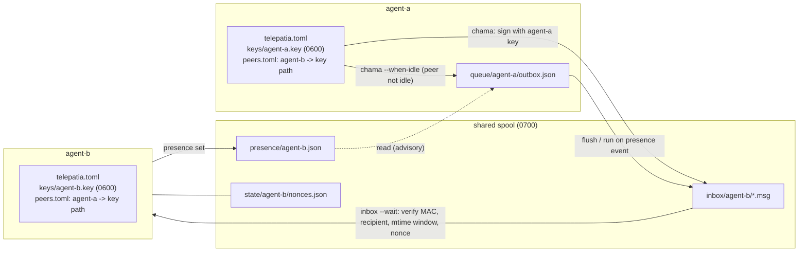

# Telepatia kit (organism_continuity.telepatia)

> Integration note: this kit was applied as a patch series on top of commit
> `cb8f368` ("Fix legacy ruff findings outside the messaging kit", on top of 42ed440) of the
> `release/v0.5-structure` branch. It lives in `src/organism_continuity/telepatia/`, its tests in
> `tests/`, its normative protocol in `docs/PROTOCOL.md`, examples in `examples/telepatia/`, and
> the security policy and threat model in the repository `SECURITY.md`. The session handoff
> module is a separate package, `src/organism_continuity/handoff/` (docs: `docs/HANDOFF.md`).
> This page may be merged into the root README later.

Signed, file-based messages between AI agents (or any processes) that run on the same machine.

- Per-sender HMAC-SHA256 signatures, verified with a constant-time compare.
- One read path, and it only returns verified messages. Unsigned, forged, replayed,
  misaddressed or stale files are quarantined and counted, never shown.
- Event-driven waiting (inotify on Linux, kqueue on macOS/BSD). No polling loops.
- Advisory presence (`idle`, `busy`, `absent`, `unknown`) and a persistent outbox that holds a
  message until the peer is idle.
- Session handoff packages for moving work from a long session to a fresh one, in a separate
  package (`organism_continuity.handoff`, command `telepatia-handoff`) that reuses the kit's signing.
- Python 3.10+, standard library only (on 3.10 a strict built-in TOML subset parser replaces `tomllib`).

## Architecture



## Wire format

Every message is plain text ending in one `telepatia-sig v=1` trailer line:

```
to: agent-b
from: agent-a

synthetic example body
<!-- telepatia-sig v=1 from=agent-a ts=1700000000 nonce=<32 hex> mac=<64 hex> -->
```

The trailer and its HMAC-SHA256 canonical form are byte-for-byte the format of the text channel
the kit was extracted from, so either side verifies the other's trailers with the same key.
`docs/PROTOCOL.md` is the normative specification, with test vectors in
`tests/vectors/telepatia-sig-v1.json`.

## Threat model in short

Protects against: a process or person that can write files into the spool but does not hold a
sender's key. Such a writer cannot make a message appear to come from that sender, cannot edit
or redirect a signed message, and cannot replay one: freshness is checked against the file's
mtime (the transport time, never the signed timestamp alone, 600 s window) and accepted nonces
are persisted in a store that fails closed.

Does not protect against: anyone who can read the key files (the same Unix user, root, a
backup). HMAC is symmetric, so every peer holding `agent-a.key` could also sign as `agent-a`.
Messages are not encrypted. Presence files are not signed. See `SECURITY.md` and
`docs/PROTOCOL.md`.

## Install

From a checkout of the repository root, with either tool:

```bash
pipx install .           # or: uv tool install .
telepatia --version
```

## Quickstart: two agents on one machine

```bash
export DEMO="$(mktemp -d)"

# 1. Each agent creates its config, its key (0600, in a 0700 dir) and its inbox.
telepatia init --name agent-a --config "$DEMO/a/telepatia.toml" --spool "$DEMO/spool"
telepatia init --name agent-b --config "$DEMO/b/telepatia.toml" --spool "$DEMO/spool"

# 2. Exchange keys out-of-band. On one machine this is a local file copy; across machines use
#    an encrypted channel. `peer add` copies the key into the receiver's keys dir with 0600 and
#    records only the name and path in peers.toml.
telepatia peer add agent-a --key-file "$DEMO/a/keys/agent-a.key" --config "$DEMO/b/telepatia.toml"
telepatia peer add agent-b --key-file "$DEMO/b/keys/agent-b.key" --config "$DEMO/a/telepatia.toml"

# 3. Compare fingerprints through a second channel.
telepatia key fingerprint --config "$DEMO/a/telepatia.toml"
telepatia peer list --config "$DEMO/b/telepatia.toml"

# 4. agent-b waits for mail (blocks on file events, returns when a verified message arrives).
telepatia inbox --wait --config "$DEMO/b/telepatia.toml" &

# 5. agent-a sends.
telepatia chama agent-b "build finished, please review" --config "$DEMO/a/telepatia.toml"
```

Hold a message until the peer is idle:

```bash
telepatia presence set busy --task "running tests" --config "$DEMO/b/telepatia.toml"
telepatia chama agent-b "when you are free" --when-idle --config "$DEMO/a/telepatia.toml"
telepatia outbox run --config "$DEMO/a/telepatia.toml" &      # waits for presence changes
telepatia presence set idle --config "$DEMO/b/telepatia.toml"   # the outbox delivers now
```

Agents should publish presence on their own events (turn start, turn end), not on a timer.
See `examples/telepatia/` for ready-made configs and a script that runs this flow, and `examples/handoff/`
for the handoff configuration section and demo.

## Key rotation and revocation

```bash
telepatia key rotate --config "$DEMO/a/telepatia.toml"          # prints new and replaced fingerprints
# deliver the new agent-a.key out-of-band, then on agent-b:
telepatia peer remove agent-a --config "$DEMO/b/telepatia.toml"
telepatia peer add agent-a --key-file /path/to/new/agent-a.key --config "$DEMO/b/telepatia.toml"

telepatia key revoke agent-a --yes --config "$DEMO/b/telepatia.toml"   # drop a peer key
```

Full procedure: `docs/PROTOCOL.md`, section 9.

## Configuration reference

`telepatia.toml` (one per agent; default `$TELEPATIA_CONFIG`, else `~/.config/telepatia/telepatia.toml`).
Relative paths resolve against the directory of the file.

| Key | Required | Meaning |
|-----|----------|---------|
| `[identity] name` | yes | This agent's name: lowercase `[a-z0-9._-]`, max 64. |
| `[identity] key_file` | yes | This agent's signing key (mode 0600). |
| `[spool] dir` | yes | Shared directory with `inbox/`, `presence/`, `queue/`, `state/`. |
| `[peers] file` | no | Peers file, default `peers.toml` next to the config. |
| `[handoff] dir` (read by `telepatia-handoff`) | no | Handoff directory, default `<spool>/handoffs`. |
| `[handoff.lanes] <name>` | no | Session directory of a lane. |
| `[handoff.thresholds] *` | no | `log_warn_mb`, `log_handoff_mb`, `checkpoints_warn`, `checkpoints_handoff`. |

`peers.toml`: one `[peers.<name>]` table per peer with exactly one key, `key_file`. Inline key
material (`key`, `secret`, `token`, ...) and switches that would disable verification are
rejected when the config is loaded.

## CLI reference

All commands accept `--config PATH` and `--json`.

| Command | Purpose |
|---------|---------|
| `telepatia init --name N --spool DIR [--keys-dir DIR]` | Create config, key (0600), keys dir (0700), peers file, inbox. Refuses a keys dir inside a git worktree unless `--allow-in-worktree`. |
| `telepatia chama PEER TEXT...` (alias `send`) | Sign and deliver to the peer's inbox. `--when-idle` holds it in the outbox unless the peer is idle; `--queue-if-missing` holds it if the peer inbox does not exist yet. |
| `telepatia inbox [--wait] [--timeout S] [--peek]` | Return verified messages only. `--wait` blocks on file events. Exit 3 when nothing arrived. |
| `telepatia presence set idle\|busy\|absent [--task T]` | Publish this agent's presence. |
| `telepatia presence get [NAME]` | Read an agent's presence (`unknown` on any problem). |
| `telepatia outbox list\|flush\|run [--timeout S]` | Inspect the outbox, deliver what can be delivered, or wait on presence events and deliver. |
| `telepatia peer add NAME --key-file F` / `remove NAME` / `list` | Manage peers; `list` shows fingerprints. |
| `telepatia key fingerprint\|rotate\|revoke [NAME] [--yes]` | Key lifecycle. Never prints key material. |
| `telepatia-handoff status\|package\|absorb\|pending` | Session handoff packages (separate command and package), see `docs/HANDOFF.md`. |
| `telepatia relay ORIGIN TEXT... [--to N] [--reply-to ID] [--sign]` | Print a relay body for ORIGIN to stdout. Unsigned unless `--sign`; `--sign` signs as this agent (the relayer) with its own key and needs `--config`. |
| `telepatia verify-text [FILE] --receive-time T [--ledger F] [--dry-run]` | Verify a signed text from another transport (stdin by default) against the transport's receive time `T` (epoch or ISO-8601), claiming its nonce once in a replay ledger (default `<spool>/state/<name>/channel-ledger.json`). `--dry-run` checks with a read-only ledger and claims nothing. Prints the content only when verified; exit 4 when rejected. |
| `telepatia doctor` | Check keys, peer keys and directory modes. |

Exit codes: 0 success, 1 error (message on stderr), 2 usage, 3 inbox empty, 4 text rejected
(`verify-text`).

## Security notes

- Keep key directories outside git worktrees; `init` refuses otherwise. The shipped
  `.gitignore` excludes keys, inboxes, presence, queues and local configs.
- Never paste key material into chat, issues or logs; compare fingerprints instead.
- There is deliberately no command that prints unverified messages. Quarantined files are kept
  under `inbox/<name>/rejected/` for manual inspection.
- `wait` and `outbox run` sleep on kernel file events. If neither inotify nor kqueue is
  available they fail rather than fall back to polling.

## Development

```bash
uv sync --extra dev
uv run pytest --cov
uv run ruff check .
```

See `CHANGELOG.md`. License: MIT (see `LICENSE` and `NOTICE`).
